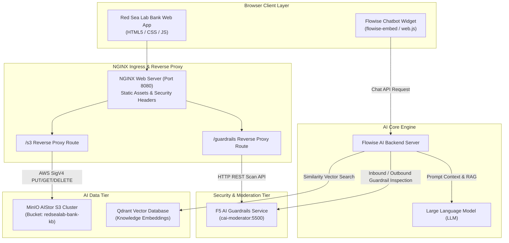
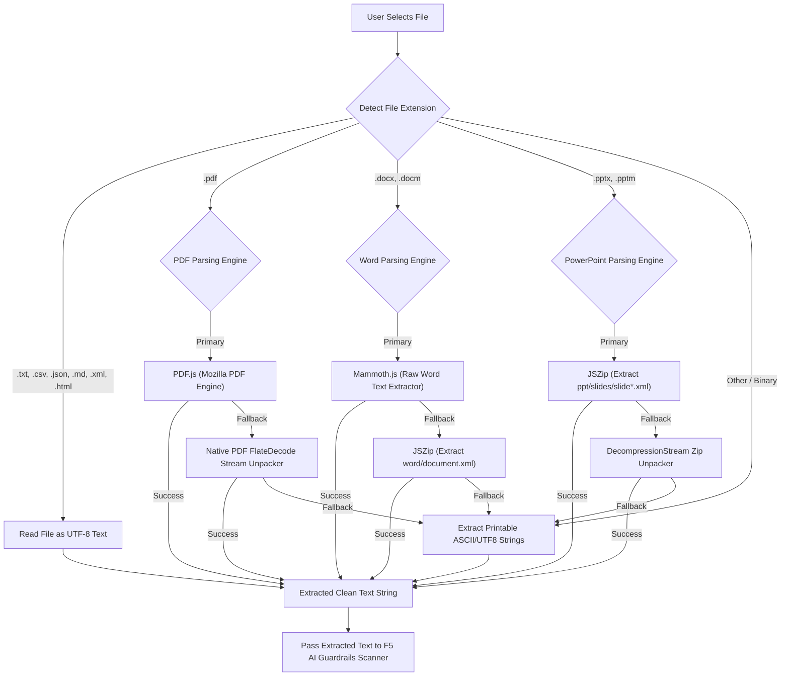

# Red Sea Lab Bank Web Application

A full-stack sample web application for **Red Sea Lab Bank**. Embedded with a **Flowise AI Chatbot** widget and built for non-root execution on **Red Hat OpenShift** and **Kubernetes**.

GitHub Repository: [https://github.com/gregcoward/redsealab_bank](https://github.com/gregcoward/redsealab_bank)

---

## Table of Contents
1. [Overview & Features](#overview--features)
2. [System Architecture & Workflow Diagrams](#system-architecture--workflow-diagrams)
   - [Overall System Architecture](#overall-system-architecture)
   - [Document Upload & 3-Step Guardrails Scan Pipeline](#document-upload--3-step-guardrails-scan-pipeline)
   - [Document Text Extraction Engine Flow](#document-text-extraction-engine-flow)
   - [MinIO AIStor S3 SigV4 Authentication & Data Flow](#minio-aistor-s3-sigv4-authentication--data-flow)
   - [Flowise Chatbot, F5 Guardrails & Qdrant RAG Flow](#flowise-chatbot-f5-guardrails--qdrant-rag-flow)
3. [User Credentials & Authentication Screen](#user-credentials--authentication-screen)
4. [Using the Application](#using-the-application)
5. [Flowise AI Chatbot Integration & Configuration](#flowise-ai-chatbot-integration--configuration)
6. [MinIO AIStor S3 & F5 AI Guardrails Administration](#minio-aistor-s3--f5-ai-guardrails-administration)
7. [Customization & Code Update Guide](#customization--code-update-guide)
   - [Modifying UI Layout & Themes](#modifying-ui-layout--themes)
   - [Adding, Editing, or Removing Users](#adding-editing-or-removing-users)
   - [Adding New Tabs, Pages, or API Endpoints](#adding-new-tabs-pages-or-api-endpoints)
8. [Building Container Images](#building-container-images)
   - [Building with Docker or Podman](#building-with-docker-or-podman)
   - [Building inside OpenShift (BuildConfig / ImageStream)](#building-inside-openshift-buildconfig--imagestream)
9. [Deploying to OpenShift & Kubernetes (Namespace Options)](#deploying-to-openshift--kubernetes-namespace-options)
   - [Specifying Target Namespace](#specifying-target-namespace)
   - [OpenShift Deployment Options](#openshift-deployment-options)
   - [Standard Kubernetes Deployment (kubectl)](#standard-kubernetes-deployment-kubectl)
10. [Repository File Map](#repository-file-map)

---

## Overview & Features

- **User Authentication Screen**: Full-screen modal login interface with session persistence (`sessionStorage`), error handling, and pre-configured demo account quick-fill chips.
- **Frontend Portal**: Banking dashboard for Red Sea Lab Bank featuring portfolio balances, checking & savings accounts, recent transactions log, money transfer interface, refer-a-friend card, microservice health status monitor, and Administrator Document Portal.
- **Administrator Document Portal**: MinIO AIStor S3 cluster document browser, document uploader, and F5 AI Guardrails security scanning configuration.
- **Client-Side Multi-Format Document Parsing Engine**: Extracts raw text client-side from `.docx`, `.pdf`, `.pptx`, `.txt`, `.md`, `.csv`, `.json`, `.xml`, and `.html` files before uploading.
- **3-Step Security Scan Upload Pipeline**: Runs document text through F5 AI Guardrails for PII, exfiltration, prompt injection, and malware scanning. Blocks upload to S3 if a policy violation occurs.
- **Embedded AI Chatbot**: Integrated Flowise Chatbot widget connecting to the Flowise AI backend, Qdrant vector database, and F5 AI Guardrails moderation endpoints.
- **OpenShift Non-Root Security**: Uses `nginxinc/nginx-unprivileged:alpine` listening on non-privileged TCP port `8080`, fully compliant with OpenShift's restricted `SecurityContextConstraints` (SCC).
- **Multi-Cloud Ready**: Complete manifests for both OpenShift (`Route`, `BuildConfig`, `ImageStream`) and standard Kubernetes (`Deployment`, `Service`, `Ingress`).

---

## System Architecture & Workflow Diagrams

### Overall System Architecture

The diagram below highlights the components of the Red Sea Lab Bank platform and how the NGINX Edge Web Server, MinIO AIStor S3 Cluster, F5 AI Guardrails Moderation Engine, Flowise Chatbot, and Qdrant Vector DB interact:



---

### Document Upload & 3-Step Guardrails Scan Pipeline

When an administrator uploads a document to MinIO AIStor, the application executes a mandatory 3-step security pipeline:

```mermaid
sequenceDiagram
    autonumber
    actor Admin as Administrator
    participant Portal as Admin Document Portal
    participant Extractor as Document Extraction Engine
    participant Guardrails as F5 AI Guardrails Proxy (/guardrails)
    participant S3 as MinIO AIStor S3 Cluster (/s3)

    Admin->>Portal: Select File & Click "Upload Document"
    activate Portal
    
    rect rgb(30, 41, 59)
        note over Portal,Extractor: Step 1: Text Extraction Engine
        Portal->>Extractor: Pass File ArrayBuffer (PDF, DOCX, PPTX, TXT, etc.)
        Extractor-->>Portal: Extracted Plain Text String
    end

    rect rgb(15, 23, 42)
        note over Portal,Guardrails: Step 2: F5 AI Guardrails Security Scan
        Portal->>Guardrails: POST /guardrails/backend/v1/scans (Extracted Text, Bearer Token)
        alt Security Scan Violation Detected (Blocked / Flagged)
            Guardrails-->>Portal: HTTP 200/400 (Outcome: Blocked / Flagged, Scanner Results)
            Portal-->>Admin: Display ⛔ UPLOAD BLOCKED Error Alert (Abort Upload)
        else Security Scan Cleared
            Guardrails-->>Portal: HTTP 200 (Outcome: Cleared, 0 Violations)
        end
    end

    rect rgb(30, 41, 59)
        note over Portal,S3: Step 3: AWS SigV4 Signed S3 Upload
        Portal->>Portal: Compute AWS SigV4 HMAC-SHA256 Authorization Headers
        Portal->>S3: PUT /s3/redsealab-bank-kb/<object-key> (Headers + File Binary)
        S3-->>Portal: HTTP 200 / 201 Created
        Portal->>Portal: Refresh Document List
        Portal-->>Admin: Display ✅ Upload Success Banner
    end
    deactivate Portal
```



---

### Document Text Extraction Engine Flow

The client-side document extraction engine parses text natively in the browser without sending unencrypted document binaries to external third-party conversion APIs:



---

### MinIO AIStor S3 SigV4 Authentication & Data Flow

MinIO AIStor S3 cluster operations (`GET`, `PUT`, `DELETE`, `LIST`) are authenticated directly from the browser using AWS Signature Version 4 (`AWS4-HMAC-SHA256`) and proxied through NGINX:

```mermaid
flowchart LR
    subgraph UI ["Browser Client"]
        Form["S3 Actions\n(Upload / List / Delete / Download)"]
        SigV4["AWS SigV4 Engine\n(WebCrypto HMAC-SHA256)"]
    end

    subgraph NGINXProxy ["NGINX Edge Proxy (/s3)"]
        HeaderParse["Extract Target Proxy Headers:\nX-S3-Target-Host\nX-S3-Proto"]
        ProxyPass["Forward Request to Dynamic S3 Endpoint"]
    end

    subgraph MinIO ["MinIO AIStor Cluster"]
        S3Endpoint["AIStor S3 API Endpoint\n(e.g., https://aistor-primary-hl:9000)"]
        Bucket["S3 Bucket:\nredsealab-bank-kb"]
    end

    Form -->|1. Request Payload| SigV4
    SigV4 -->|2. Compute SigV4 Authorization Header| HeaderParse
    HeaderParse -->|3. Pass Request with Preserved SigV4 Headers| ProxyPass
    ProxyPass -->|4. Authenticated S3 Operation GET / PUT / DELETE| S3Endpoint
    S3Endpoint -->|5. Read / Write Bucket Objects| Bucket
```



---

### Flowise Chatbot, F5 Guardrails & Qdrant RAG Flow

When a user interacts with the Flowise Chatbot widget, inbound user prompts and outbound LLM responses pass through F5 AI Guardrails security scanning while vector context is retrieved from Qdrant:

```mermaid
sequenceDiagram
    autonumber
    actor User as Customer / User
    participant ChatWidget as Flowise Chat Bubble Widget
    participant Flowise as Flowise AI Orchestrator
    participant Guardrails as F5 AI Guardrails Moderation
    participant Qdrant as Qdrant Vector Database
    participant LLM as LLM Engine

    User->>ChatWidget: Type Chat Prompt (e.g., "What are checking interest rates?")
    activate ChatWidget
    ChatWidget->>Flowise: POST /api/v1/prediction (User Prompt)
    activate Flowise

    rect rgb(30, 41, 59)
        note over Flowise,Guardrails: Inbound Prompt Guardrail Inspection
        Flowise->>Guardrails: POST /backend/v1/scans (Direction: Request / Inbound)
        alt Prompt Injection / Malicious Intent Detected
            Guardrails-->>Flowise: Outcome: Blocked / Flagged
            Flowise-->>ChatWidget: Return Safety Violation Response
        else Prompt Cleared
            Guardrails-->>Flowise: Outcome: Cleared
        end
    end

    rect rgb(15, 23, 42)
        note over Flowise,Qdrant: Similarity Search RAG Context Retrieval
        Flowise->>Qdrant: Query Vector Embeddings (Top-K Similarity Match)
        Qdrant-->>Flowise: Return Knowledge Base Document Chunks
    end

    rect rgb(30, 41, 59)
        note over Flowise,LLM: LLM Text Generation
        Flowise->>LLM: Pass System Prompt + Knowledge Chunks + User Prompt
        LLM-->>Flowise: Generated Answer Text
    end

    rect rgb(15, 23, 42)
        note over Flowise,Guardrails: Outbound Response Guardrail Inspection
        Flowise->>Guardrails: POST /backend/v1/scans (Direction: Response / Outbound)
        alt Data Exfiltration / PII Leakage Detected
            Guardrails-->>Flowise: Outcome: Blocked / Censored
            Flowise-->>ChatWidget: Return Redacted Safety Message
        else Response Cleared
            Guardrails-->>Flowise: Outcome: Cleared
        end
    end

    Flowise-->>ChatWidget: Return Validated AI Response Payload
    deactivate Flowise
    ChatWidget-->>User: Render Response Message in Chat Window
    deactivate ChatWidget
```



---

## User Credentials & Authentication Screen

The application includes an authentication screen that prompts for user login upon opening. You can sign in using any of the demo accounts below (or click the quick-login chips on the sign-in modal):

| Account Name | Role / Tier | Email Address | Password |
| :--- | :--- | :--- | :--- |
| **Jane Doe** | Premium Tier | `jane.doe@redsealabbank.com` | `password123` |
| **Alex Smith** | Standard Tier | `alex.smith@redsealabbank.com` | `admin123` |
| **adminuser** | Administrator | `adminuser@redsealabbank.com` | `F5testnet!` |

### Auth Session & Logout
- **Session Persistence**: Logging in saves the active session state in `sessionStorage`. Reloading or navigating tabs preserves the logged-in session.
- **Logging Out**: Click the **Log Out** button in the top navbar user profile area to clear session storage and return to the login screen.

---

## Using the Application

### 1. Login Screen
- Enter valid credentials or click one of the quick-login chips (**Jane Doe**, **Alex Smith**, or **adminuser**).
- Click **Sign In** to unlock the banking dashboard. Logging in as an Administrator (`adminuser`) unlocks access to the **Administrator Document Portal** tab.

### 2. Dashboard Tab
- **Portfolio Summary**: Displays user-specific total portfolio balance, percentage growth, and individual checking/savings accounts.
- **Recent Transactions**: Lists completed financial transactions, categories, and targeted backend API endpoints (`/api/transfer`, `/app3/referral`, `/files/payroll`). Click **Refresh** to trigger a mock data refresh.

### 3. Money Transfer Tab
- Select source account (Checking or Savings).
- Enter recipient name/account ID, transfer amount ($), and optional memo.
- Click **Send Transfer**. The transfer payload is sent to the `/api/v1/transfer` endpoint, displays a success notification banner, and dynamically prepends the new transaction to the **Recent Transactions** table on the Dashboard.

### 4. Refer-a-Friend Tab
- Copy your user-specific referral URL (`https://redsealabbank.apps.openshift.com/invite/<USER_CODE>`) to the clipboard with one click.
- Enter a friend's email address and click **Send Invitation**. Dispatches an invitation request to `/app3/referral`.

### 5. Microservices Status Tab
- Displays real-time operational status for Red Sea Lab Bank microservices:
  - **Main Web Frontend** (`/`)
  - **Backend Service** (`/files`)
  - **Money Transfer API** (`/api`)
  - **Referral Service** (`/app3`)

### 6. Administrator Document Portal Tab (Admin Only)
- Accessible to users logged in with `isAdmin: true` (`adminuser`).
- **MinIO AIStor S3 Cluster Configuration**: Configure S3 Endpoint URL, bucket name, proxy route, access key, secret key, and view connection status. Click **Configure** to expand/collapse configuration fields.
- **F5 AI Guardrails Out-of-Band Security Scanning**: Configure Guardrails endpoint, bearer authorization token, project ID, scan direction (request/response), and proxy route path.
- **Upload Document**: Upload knowledge base documents to MinIO AIStor with automatic client-side text extraction and F5 Guardrails security scanning.

### 7. Flowise AI Assistant (Chat Bubble)
- Click the floating chat bubble icon in the bottom-right corner of the web page to open the interactive AI assistant powered by Flowise.
- Ask questions about banking products, financial advice, or transfer policies.

---

## Flowise AI Chatbot Integration & Configuration

The Flowise Chatbot is initialized near the bottom of [`src/index.html`](src/index.html):

```html
<script type="module">
    import Chatbot from "https://cdn.jsdelivr.net/npm/flowise-embed/dist/web.js"
    Chatbot.init({
        chatflowid: "890c94ce-5c7a-4efa-9038-e5b530c212f3",
        apiHost: "https://flowise-local-ai-lab.apps.ai-guardrails.bd.f5.com",
    })
</script>
```

---

## MinIO AIStor S3 & F5 AI Guardrails Administration

### MinIO AIStor S3 Cluster Settings
- **Endpoint URL**: `https://aistor-primary-hl.aistor-primary.svc.cluster.local:9000` (supports custom external AIStor endpoints).
- **Target Bucket**: `redsealab-bank-kb`
- **Proxy Endpoint**: `/s3`
- **Authentication**: AWS Signature Version 4 (`AWS4-HMAC-SHA256`).

### F5 AI Guardrails Settings
- **Endpoint URL**: `http://cai-moderator.cai-moderator.svc.cluster.local:5500`
- **Authorization Token**: Bearer Secret Token
- **Project ID**: `01a160ee-5a3d-7010-9d6c-2bba263f77df`
- **Scan Direction**: `request` (Inbound Upload Scans) / `response` (Outbound Generation Scans)
- **Proxy Route**: `/guardrails`

---

## Customization & Code Update Guide

### Modifying UI Layout & Themes

All design tokens are defined as CSS variables at the top of [`src/styles.css`](src/styles.css):

```css
:root {
    --bg-primary: #0f172a;       /* Main dark background */
    --bg-secondary: #1e293b;     /* Card & dropdown background */
    --border-color: #334155;     /* Border lines */
    --text-primary: #f8fafc;     /* Main white text */
    --accent-blue: #38bdf8;      /* Primary brand accent */
}
```

---

### Adding, Editing, or Removing Users

User accounts and credentials are defined in the `USERS_DB` object inside [`src/app.js`](src/app.js).

To grant a user administrative access to the **Administrator Document Portal** tab, set `isAdmin: true` in their account configuration object:

```javascript
const USERS_DB = {
    'jane.doe@redsealabbank.com': {
        email: 'jane.doe@redsealabbank.com',
        password: 'password123',
        name: 'Jane Doe',
        avatar: 'JD',
        status: 'Premium Tier',
        isAdmin: false,
        checkingNum: '•••• 4829',
        checkingBalance: 24150.25,
        savingsNum: '•••• 9102',
        savingsBalance: 104300.55,
        referralCode: 'JD-8902'
    },
    // Admin user configuration with Admin Portal access
    'adminuser@redsealabbank.com': {
        email: 'adminuser@redsealabbank.com',
        password: 'F5testnet!',
        name: 'adminuser',
        avatar: 'AD',
        status: 'Administrator',
        isAdmin: true, // Grants access to Administrator Document Portal tab
        checkingNum: '•••• 0001',
        checkingBalance: 1250000.00,
        savingsNum: '•••• 0002',
        savingsBalance: 5000000.00,
        referralCode: 'ADMIN-001'
    }
};
```

---

## Building Container Images

### Building with Docker or Podman (Docker Hub)

```bash
# Build container image tagged for Docker Hub (linux/amd64 architecture)
docker build --platform linux/amd64 -t gregcoward/redsealab_bank:latest .

# Test run locally on port 8080
docker run -d -p 8080:8080 --name redsealab-bank-app gregcoward/redsealab_bank:latest

# Verify local health endpoint
curl http://localhost:8080/healthz

# Log in to Docker Hub and push the image
docker login -u gregcoward
docker push gregcoward/redsealab_bank:latest
```

---

## Deploying to OpenShift & Kubernetes (Namespace Options)

The deployment script [`deploy.sh`](deploy.sh) allows you to specify any target OpenShift namespace/project using named flags or positional parameters.

### Specifying Target Namespace

```bash
# Option 1: Using the -n or --namespace flag (Default: redsealab-bank)
./deploy.sh -n redsealab-bank

# Option 2: Using positional arguments [NAMESPACE] [METHOD] [REGISTRY]
./deploy.sh redsealab-bank external docker.io/gregcoward/redsealab_bank:latest

# Option 3: Setting the NAMESPACE environment variable
NAMESPACE="prod-redsealab-bank" ./deploy.sh
```

### OpenShift Deployment Options

#### Option A: External Docker Hub Build (Recommended)
Builds the container image locally targeting `linux/amd64`, pushes to Docker Hub, and deploys to the specified namespace:

```bash
./deploy.sh -n redsealab-bank -m external
```

#### Option B: In-Cluster OpenShift Build
Uses OpenShift ImageStream & BuildConfig resources:

```bash
./deploy.sh -n redsealab-bank -m openshift-build
```

---

## Repository File Map

| Path | Purpose |
| :--- | :--- |
| [`Dockerfile`](Dockerfile) | Multi-stage unprivileged NGINX build file (port 8080). |
| [`nginx.conf`](nginx.conf) | Unprivileged web server configuration with security headers, `/s3`, `/guardrails` reverse proxies & `/healthz` probe. |
| [`deploy.sh`](deploy.sh) | Automated OpenShift deployment helper script supporting explicit namespace options. |
| [`src/index.html`](src/index.html) | Main HTML document for Red Sea Lab Bank with Admin Portal & Flowise Chatbot embed code. |
| [`src/styles.css`](src/styles.css) | Custom CSS styling & modal screen styles. |
| [`src/app.js`](src/app.js) | Auth manager, SigV4 generator, document text extractors (PDF, DOCX, PPTX), F5 Guardrails API scanner & S3 uploader. |
| [`openshift/deployment.yaml`](openshift/deployment.yaml) | Kubernetes Deployment with readiness/liveness probes & non-root SCC. |
| [`openshift/service.yaml`](openshift/service.yaml) | Kubernetes ClusterIP Service listening on port 8080. |
| [`openshift/route.yaml`](openshift/route.yaml) | OpenShift Route with Edge TLS termination. |
| [`openshift/buildconfig.yaml`](openshift/buildconfig.yaml) | OpenShift BuildConfig and ImageStream resources. |

---

## Support & Contributions

To push updates to GitHub:
```bash
git add .
git commit -m "Add mermaid workflow diagrams for AIStor, F5 Guardrails, and Flowise RAG"
git push origin main
```
Repository URL: [https://github.com/gregcoward/myarcadia](https://github.com/gregcoward/myarcadia)
